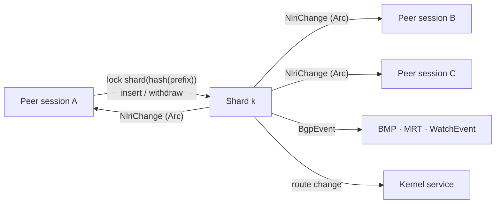
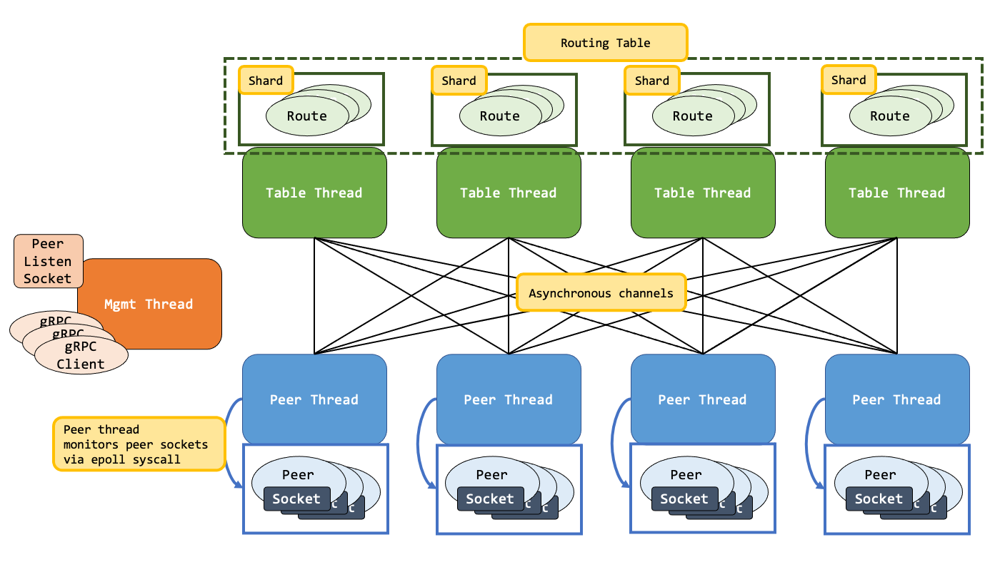

# Concurrency model

RustyBGP runs on one tokio multi-thread runtime. There are no dedicated OS
threads per peer or per table shard; instead, work is divided into many
lightweight tasks that the runtime schedules across all cores.

## Tasks

| Task | Count | Role |
|---|---|---|
| Main event loop | 1 | Accepts inbound BGP connections, receives completed outbound connections, and handles kernel and BFD events. |
| Peer session | 1 per TCP connection | Runs the FSM, parses UPDATEs, writes them into the table, and builds and sends UPDATEs to its peer. During a connection collision a peer briefly has two. |
| Active connect | 1 per non-passive peer | Retries the outbound TCP connection (5-second connect timeout, `connect-retry` interval between attempts) and hands the socket to the main loop. |
| gRPC server | 1 | Serves `GoBgpService`, plus short-lived tasks for streaming responses. |
| Configuration reloader | 1 | Waits for SIGHUP and applies configuration changes. |
| Kernel service | 0 or 1 | Owns the netlink socket. |
| BFD | 1 + 1 per BFD peer | A UDP server on port 3784 and a state machine per session. |
| BMP, RPKI, MRT | 1 per station, cache or dump file | Clients and writers. |
| Timers | as needed | Graceful Restart, LLGR, RT-Constraint and selection-deferral timers. |

## The sharded routing table

The `TableManager` holds the routing table as a vector of shards, each
protected by its own mutex.

- **Shard count.** One shard per CPU, capped at 255. The daemon logs the CPU
  count at startup:

    ```text
    Hello, RustyBGPd (32 cpus)!
    ```

- **Placement.** A prefix's shard is chosen by an FNV hash of its NLRI modulo
  the shard count. A prefix therefore always lives in exactly one shard, and
  all paths for it, from every peer, are compared there.
- **No table thread.** A peer session that receives an UPDATE calls into the
  table directly and holds only the lock of the shard that owns the prefix.
  Two peers updating prefixes in different shards never contend.
- **Fan-out.** When a destination's paths change, the shard sends a
  reference-counted change record to every registered peer session over that
  session's channel. Export processing then happens in each peer's task,
  outside the shard lock.



## Channels

| Channel | From → To | Carries |
|---|---|---|
| Active connections | Active-connect tasks → main loop | Established outbound TCP streams |
| Peer events | Table shards → peer session | Best-path change records, soft-reset-out and route-refresh requests |
| Kernel requests | Table shards, gRPC → kernel service | Route install and withdraw, nexthop registration, VRF device management |
| Kernel events | Kernel service → main loop | Redistributed routes, address changes, nexthop reachability changes |
| BFD events | BFD → main loop | Session-down notifications |
| Subscribers | Table shards → BMP, MRT, `WatchEvent` | Pre-policy, post-policy and Loc-RIB events |
| Close | Collision handling, admin actions → peer session | The reason to close a connection and the NOTIFICATION to send |

## Shared state and locking

| State | Protection | Notes |
|---|---|---|
| Global configuration: peers, peer groups, policies, BMP/RPKI/MRT registries | Async read-write lock | Peer sessions do not hold it while routing. They take it only for Graceful Restart bookkeeping and teardown. |
| Per-peer runtime state (FSM state, negotiated capabilities, export policy) | Atomics and lock-free swaps | Readable from the gRPC service without blocking the session. |
| Connection arbitration (FSM and the two connection slots) | A per-peer mutex | Makes collision detection atomic without touching the global lock. |
| Routing table | One mutex per shard | |
| RPKI ROA table | Read-write lock | Policies that do not use RPKI conditions skip it entirely. |
| Global import and export policy, VRF map, subscriber list, nexthop reachability | Lock-free atomic swap (`ArcSwap`) | Policy changes take effect without stopping route processing. |

## Socket I/O and backpressure

Each peer session waits on its socket, its timers and its event channel at the
same time. It reads into a 128 KiB buffer and parses as many complete messages
as are available. On the send side, pending advertisements and withdrawals are
accumulated per address family. A later change to the same prefix replaces an
earlier one that has not been sent yet, so a flapping prefix produces at most
one UPDATE per flush. The session asks for write readiness only when it has
something to send.

!!! info "About the original design diagram"

    Early versions of RustyBGP used dedicated table threads and peer threads
    driven by `epoll`, as shown below. The current implementation keeps the
    sharded table and the channel-based fan-out, but runs everything as tokio
    tasks, and peers write into the table directly under the shard lock.

    
