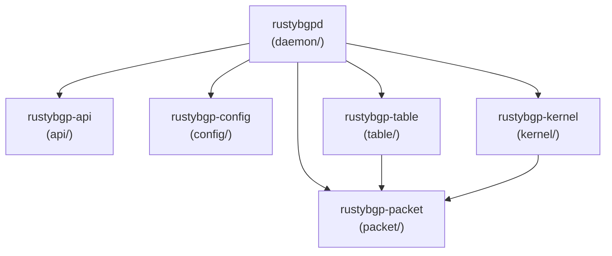

# Workspace crates

The repository is a Cargo workspace with six members. Only `rustybgpd` is a
binary; the others are libraries.

| Crate | Directory | Responsibility |
|---|---|---|
| `rustybgp-packet` | `packet/` | Wire formats and codecs. BGP messages and the per-session `PeerCodec`, path attributes, and every supported NLRI type: VPN, labeled unicast, EVPN, FlowSpec, BGP-LS, SR Policy, MUP, RT-Constraint, Prefix-SID and Tunnel Encapsulation. Also the BMP, MRT, RPKI-RTR and BFD codecs. |
| `rustybgp-table` | `table/` | RIB data structures (`Table`, `Rib`, `Destination`, `Path`, `Source`), best-path selection, the RPKI ROA table, and the policy engine. |
| `rustybgp-kernel` | `kernel/` | Linux FIB integration over rtnetlink: route installation, ECMP, VRF devices, nexthop tracking, address and route redistribution, and IPv6 neighbor lookup for unnumbered peers. |
| `rustybgp-config` | `config/` | Configuration file types and validation. Most types are generated from the OpenConfig BGP and routing-policy YANG models plus GoBGP's extensions. |
| `rustybgp-api` | `api/` | Rust bindings for the GoBGP v4 protobuf definitions, generated at build time with `tonic-prost-build`. |
| `rustybgpd` | `daemon/` | The daemon: startup, the main event loop, peer sessions and FSM, the sharded table manager, the gRPC service, and the BMP, BFD, RPKI and MRT clients. |

## Notable implementation choices

- **Allocator.** `rustybgpd` uses jemalloc as its global allocator.
- **Runtime.** Everything runs on a single tokio multi-thread runtime.
- **Release profile.** Release builds use link-time optimization.
- **Linux only.** The `kernel` crate refuses to compile on other operating
  systems, and the daemon always depends on it.
- **Generated configuration types.** `config/src/generate.rs` is generated by
  the pyang plugin in `tools/pyang_plugins/` and must not be edited by hand.
  Hand-written validation lives in `config/src/validate.rs`.
- **Version string.** The build embeds the short Git commit hash, so the version
  reported by the daemon has the form `v0.2.0-<hash>`.

## Where to look

| If you want to change... | Start in |
|---|---|
| How a message or attribute is parsed or encoded | `packet/src/bgp.rs` and the per-family modules in `packet/src/` |
| Best-path selection | `table/src/lib.rs` |
| Policy matching or actions | `table/src/policy.rs` |
| Session state handling | `daemon/src/fsm.rs`, `daemon/src/event/mod.rs` |
| What gets advertised to a peer | `daemon/src/event/export.rs`, `daemon/src/peer_tx.rs` |
| Graceful Restart and LLGR | `daemon/src/gr.rs` |
| A gRPC handler | `daemon/src/event/grpc.rs`, conversions in `daemon/src/convert.rs` |
| Configuration file handling and reload | `config/src/validate.rs`, `daemon/src/event/config_file.rs` |
| Kernel routes | `kernel/src/lib.rs`, `daemon/src/table_manager.rs` |
