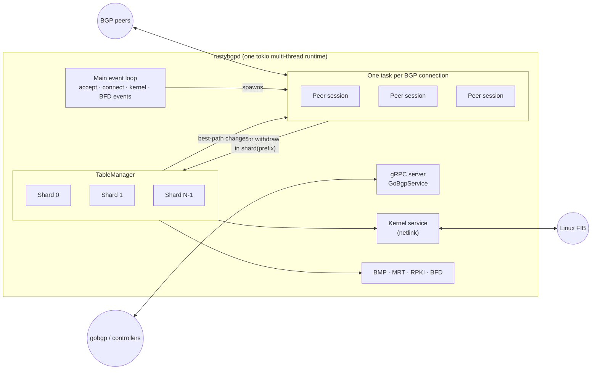

# Architecture

RustyBGP is a single Linux process, `rustybgpd`, built from a small Cargo
workspace. It is designed around three goals:

1. **Scale with cores.** The routing table is split into independent shards,
   and every BGP connection runs as its own asynchronous task, so route
   processing for different prefixes and different peers proceeds in parallel.
2. **Drop-in GoBGP compatibility.** The gRPC API, the configuration file schema
   and the `gobgp` CLI are shared with GoBGP v4.
3. **Native Linux integration.** Routes are programmed into the kernel FIB over
   netlink, without a separate Zebra or FRR process.

This section describes how the pieces fit together. It is aimed at operators
who want to understand performance and failure behavior, and at contributors
who are about to change the code.

| Page | Contents |
|---|---|
| [Workspace crates](crates.md) | The six crates and their responsibilities. |
| [Concurrency model](concurrency.md) | Tasks, table shards, channels and locks. |
| [Route processing](route-processing.md) | The path of an UPDATE from one peer to another, and best-path selection. |
| [Policy engine](policy-engine.md) | Defined sets, statements, policies and assignments. |
| [Kernel integration](kernel-integration.md) | FIB programming, ECMP, VRFs, nexthop tracking and redistribution. |
| [Subsystems](subsystems.md) | BMP, BFD, RPKI, MRT, TCP authentication, and configuration loading. |

## The system at a glance

## Design principles

**Sans-IO protocol logic.** The BGP finite state machine (`daemon/src/fsm.rs`),
the Graceful Restart state machines (`daemon/src/gr.rs`), the RT-Constraint
state machine (`daemon/src/rtc.rs`) and the outbound UPDATE batcher
(`daemon/src/peer_tx.rs`) contain no I/O and no global state. They take inputs
and return actions, which makes them straightforward to unit-test.

**Wire formats in one place.** Every encoder and decoder, for BGP itself and
for BMP, MRT, RTR and BFD, lives in the `packet` crate, which has no
dependencies on the rest of the daemon.

**Shared-nothing per prefix.** A prefix always hashes to the same shard. All
paths for that prefix, from every peer, are compared under that shard's lock,
so best-path selection needs no cross-shard coordination.

**Export is per peer.** The table publishes *what changed*; each peer session
applies its own export policy, split-horizon rules and Add-Path limits in its
own task. A slow peer never holds a table lock while it encodes or writes.
