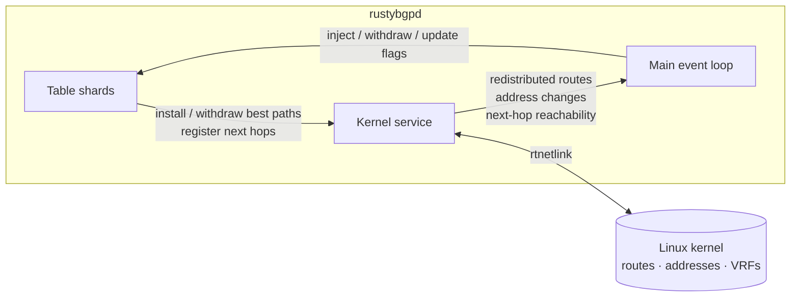

# Kernel integration

GoBGP relies on an external Zebra daemon (from FRR or Quagga) to program the
operating system's forwarding table. RustyBGP replaces that with a built-in
service in the `kernel` crate that talks to the Linux kernel directly over
rtnetlink. The `zebra` configuration section and the `EnableZebra` RPC are
kept for compatibility; they turn this service on.



The service is a single task that owns a netlink socket subscribed to the IPv4
and IPv6 route and address multicast groups.

## FIB installation

When the best path for an IPv4 or IPv6 unicast prefix changes, the owning
shard sends the new next-hop set to the kernel service:

- **No next hops** removes the route.
- **One next hop** installs a single-path route.
- **Several next hops** installs an ECMP route with `RTA_MULTIPATH`.

Routes are written with `NLM_F_CREATE | NLM_F_REPLACE` and tagged with protocol
`bgp` (`RTPROT_BGP`), so they appear as `proto bgp` in `ip route`. The best
path's MED is used as the route metric.

The ECMP set contains every eligible path that ties with the best path through
all selection steps up to, but not including, the router-ID comparison.

Only routes learned from BGP peers are installed. Routes originated through
the API and routes redistributed from the kernel are never written back to the
FIB. VPN, labeled, FlowSpec, EVPN and other non-unicast families are not
installed, except that L3VPN routes are installed into matching
[VRF tables](#vrfs).

## VRFs

When a VRF is created through the API with a non-zero `id`, the kernel service
creates a Linux VRF device bound to the routing table with that ID. VPN best
paths whose route targets match the VRF's import list are installed into that
table.

## Nexthop tracking

Every next hop used by a BGP path is registered with the kernel service, with
reference counting. The service checks reachability with a FIB lookup
(`RTM_GETROUTE` with `FIB_MATCH`), ignoring routes that RustyBGP itself
installed, so a BGP route cannot make its own next hop look reachable.

Every route change in the kernel triggers a re-check of the watched next hops.
When a next hop becomes unreachable, all paths that use it are flagged
ineligible in every shard and best-path selection runs again. When it becomes
reachable, they are restored.

## Redistribution into BGP

The service reports kernel routes from other protocols to the main loop,
which injects them into the BGP table as locally sourced paths. The
`redistribute-route-type-list` setting selects which kernel protocols are
redistributed:

| Value | Kernel protocol |
|---|---|
| `connect` | `kernel` |
| `static` | `static` |
| `ospf`, `isis`, `rip`, `eigrp`, `babel` | The routing protocol of the same name |
| `bgp`, `zebra` | `bgp`, `zebra` |

An empty list redistributes routes from every protocol except RustyBGP's own.
Unknown values are ignored. Routes without a next hop are skipped.

### Connected routes

Interface address changes are handled separately from routes. When an address
is added to or removed from an interface, the covering connected prefix is
injected into or withdrawn from BGP, with the interface address as the next
hop. Loopback and link-local addresses are excluded.

!!! note

    Connected-route events are forwarded whenever the kernel service is
    running, independent of `redistribute-route-type-list`. Use an export
    policy if you do not want to advertise them.

## Unnumbered BGP

For a neighbor configured with `neighbor-interface`, RustyBGP looks up the
peer's IPv6 link-local address in the interface's neighbor (NDP) table and
connects to it with the interface's scope ID.

## Lifecycle

- The service starts when the configuration has `zebra.config.enabled = true`,
  or when `EnableZebra` is called. A failure to start is logged and is not
  fatal.
- Changing the `zebra` section requires a restart; a SIGHUP only logs a
  warning.
- Routes installed by RustyBGP are not removed when the daemon exits. They are
  replaced when the next instance installs its own best paths. To clean up
  manually:

    ```bash
    ip route flush proto bgp
    ip -6 route flush proto bgp
    ```
