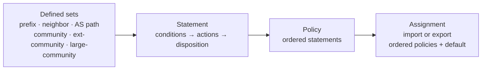
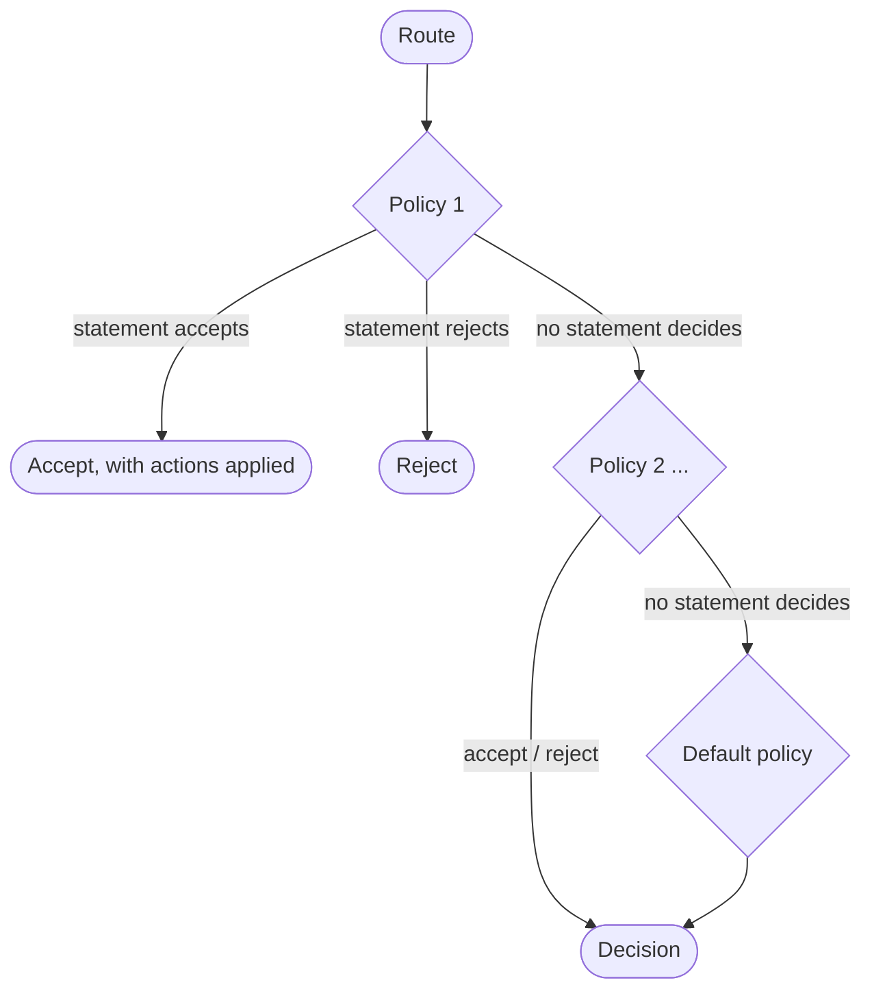

# Policy engine

The policy engine in `table/src/policy.rs` implements the OpenConfig routing
policy model used by GoBGP. The same model is reachable from the configuration
file (`defined-sets`, `policy-definitions`, `apply-policy`) and from the gRPC
policy RPCs. The [user guide](../user-guide/policy.md) shows how to write
policies; this page describes how they are represented and evaluated.

## Building blocks



### Defined sets

| Set | Representation | Matching |
|---|---|---|
| Prefix set | Longest-prefix-match trees for IPv4 and IPv6, with a mask-length range per entry | Prefix within the range |
| Neighbor set | List of IP prefixes | Peer address inside any prefix |
| AS-path set | Single-AS matchers plus regular expressions | Against the AS_PATH string |
| Community set | Regular expressions | Against `ASN:value` strings |
| Extended-community set | Regular expressions | Against the textual form, such as `rt:65000:100` |
| Large-community set | Regular expressions | Against `ASN:local1:local2` strings |

Well-known community names such as `no-export` are translated to their
numeric values before matching.

### Conditions

A statement matches only if all of its conditions match.

| Condition | Matches on |
|---|---|
| Prefix set | NLRI prefix, with `any` or `invert` |
| Neighbor set | Peer address, with `any` or `invert` |
| AS-path set | AS_PATH, with `any`, `all` or `invert` |
| Community, extended-community, large-community sets | Attribute values, with `any`, `all` or `invert` |
| Next hop in list | Path next hop |
| AS-path length | Compared with `eq`, `ge` or `le` |
| RPKI validation result | `valid`, `invalid` or `not-found` |
| Route type | `internal`, `external` or `local` |
| LOCAL_PREF, MED | Equality |
| ORIGIN | `igp`, `egp` or `incomplete` |
| Community count | Number of communities |
| Address family | The route's AFI/SAFI |

### Actions

| Action | Options |
|---|---|
| Route disposition | `accept-route`, `reject-route`, or none (continue to the next statement) |
| Set next hop | An address, `self`, `peer-address`, or `unchanged` (export only) |
| Set community, extended community, large community | `add`, `remove` or `replace` |
| Set LOCAL_PREF | Value |
| Set MED | Absolute value or a relative `+n` / `-n` adjustment |
| AS-path prepend | An AS number or the left-most AS, repeated *n* times |
| Set ORIGIN | `igp`, `egp` or `incomplete` |

## Evaluation



- Statements in a policy are evaluated in order. A statement whose conditions
  do not match passes the route to the next statement.
- A statement whose conditions match applies its actions. If it has a
  disposition, evaluation stops with that result. If it has none, evaluation
  continues with the modified route.
- Policies in an assignment are evaluated in order. The first policy that
  produces an accept or reject decides.
- If no policy decides, the assignment's default applies. When no default is
  configured, the route is **accepted**.

## Where policies apply

| Point | Scope | Notes |
|---|---|---|
| Import | Global only | Evaluated in the table shard before a path is stored. Next-hop actions are not allowed in import policies. |
| Export | Global, or per neighbor | A neighbor with its own export assignment uses it instead of the global one. Evaluated in each peer's task. |

!!! warning "Differences from GoBGP"

    - Per-neighbor **import** policy is not supported. The configuration
      validator rejects `import-policy-list` and `default-import-policy` on a
      neighbor, and any `apply-policy` on a peer group.
    - Peers created from a dynamic-neighbor range always use the global export
      policy.

## Changing policy at runtime

Policy assignments are swapped atomically, without pausing route processing.
Routes already in the table are **not** re-evaluated automatically. Run a soft
reset to apply new policies to existing routes:

```bash
gobgp neighbor 198.51.100.2 softresetin    # re-run import policy from stored originals
gobgp neighbor 198.51.100.2 softresetout   # re-run export policy and re-advertise
```

RustyBGP resets one neighbor per request; the `all` shortcut is not accepted.
See [Operations](../administration/operations.md#soft-reset) for a loop over
every neighbor.

A soft reset in uses the pre-policy attributes stored with every path, so the
peer does not have to resend its routes.
