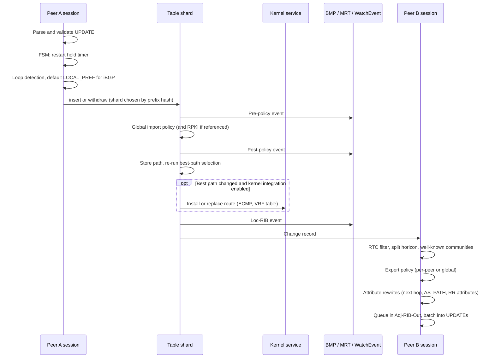

# Route processing

This page follows a route from the moment an UPDATE arrives from one peer to
the moment it is advertised to another.

## 1. Receive and parse

The peer session reads from the socket and hands complete messages to the
session's codec in the `packet` crate. The codec checks the header marker,
length and type, then decodes the path attributes and NLRI. It knows the
capabilities negotiated for this session, such as 4-octet AS numbers, Add-Path
and Extended Messages.

Validation follows RFC 7606 where the decoder supports it: a malformed
optional attribute can cause the affected routes to be treated as withdrawn
instead of resetting the session. Attributes that must not cross an AS
boundary (LOCAL_PREF, ORIGINATOR_ID and CLUSTER_LIST) are dropped when they
arrive from an eBGP peer. A single UPDATE that carries several address
families is split into one internal message per family.

## 2. Inbound checks

Before a route reaches the table, the session applies:

- **Loop detection.** If the AS_PATH contains the local AS (or confederation
  identifier), the ORIGINATOR_ID equals the local router ID, or the
  CLUSTER_LIST contains a local cluster ID, the announcement is processed as
  a withdrawal of that peer's previous path for the prefix.
- **Default LOCAL_PREF.** iBGP routes without LOCAL_PREF get the default value.
- **Prefix limit.** If a family has `max-prefixes` configured and the peer
  exceeds it, the session is closed with a Cease (Maximum Number of Prefixes
  Reached) NOTIFICATION.

## 3. Import policy and storage

The session locks the shard that owns the prefix and inserts the path:

1. A **pre-policy** event is published for BMP and MRT subscribers.
2. The **global import policy** is evaluated. If any condition references RPKI
   validation, the ROA table is consulted.
3. A **post-policy** event is published.
4. The path is stored with both its post-policy attributes and its original,
   pre-policy attributes. Keeping the originals lets a soft reset re-run
   import policy without asking the peer to resend.

The Adj-RIB-In and the Loc-RIB are one data structure. A path that import
policy rejected, or whose next hop is unreachable according to
[nexthop tracking](kernel-integration.md#nexthop-tracking), stays in the table
with a flag that makes it ineligible for best-path selection. It is still
visible through the API with `enable_filtered`.

## 4. Best-path selection

Paths for a destination are kept sorted by the following comparison. The first
rule that distinguishes two paths decides.

| Step | Rule | Preferred |
|---|---|---|
| 1 | Eligibility | Paths not filtered by policy and with a reachable next hop |
| 2 | LLGR stale | Paths without the `LLGR_STALE` community (RFC 9494) |
| 3 | EVPN MAC mobility | Higher MAC Mobility sequence number (RFC 7432) |
| 4 | LOCAL_PREF | Higher |
| 5 | AS_PATH length | Shorter (an AS_SET counts as one; confederation segments are not counted) |
| 6 | ORIGIN | IGP, then EGP, then INCOMPLETE |
| 7 | MULTI_EXIT_DISC | Lower, compared only between paths from the same neighboring AS unless `always-compare-med` is set |
| 8 | Peer type | eBGP over iBGP |
| 9 | Current best | Keep the existing eBGP best path (RFC 5004) unless `external-compare-router-id` is set |
| 10 | Router ID | Lower BGP identifier (ORIGINATOR_ID for reflected routes) |
| 11 | CLUSTER_LIST | Shorter (RFC 4456) |
| 12 | Peer address | Lower |
| 13 | Path identifier | Lower received Add-Path ID |

The result of an insert or withdrawal is a change record that says whether the
best path changed, whether any path changed (relevant for Add-Path), and the
current ordered list of paths.

!!! note "No IGP metric step"

    RustyBGP does not track IGP cost to the BGP next hop, so the RFC 4271
    §9.1.2.2 (e) interior-cost comparison is not performed.

## 5. Distribution

Still under the shard lock, the shard:

- Programs the kernel FIB if [kernel integration](kernel-integration.md) is
  enabled and the best path changed. All paths that tie with the best path up
  to the router-ID step form the ECMP set.
- Publishes a Loc-RIB event for BMP and `WatchEvent`.
- Sends the change record to every established peer session.

Export policy is not evaluated here. That work belongs to each receiving peer.

## 6. Export, per peer

Each peer session processes the change record in its own task.

**Without Add-Path**, only the best path is considered, and only when it
changed. The session then:

1. Suppresses the route if it was learned from this peer, if iBGP split
   horizon or route-reflection rules forbid it, if route-server client
   isolation applies, or if a well-known community (`NO_EXPORT`,
   `NO_ADVERTISE`, `NO_EXPORT_SUBCONFED`) forbids it.
2. Applies the RT-Constraint filter for VPN families.
3. Evaluates the export policy: the peer's own assignment if it has one,
   otherwise the global one. A rejected route that was previously advertised
   becomes a withdrawal.
4. Rewrites attributes: next hop, AS_PATH prepending (or confederation
   segments), removal of LOCAL_PREF toward eBGP, ORIGINATOR_ID and
   CLUSTER_LIST when reflecting, and the `LLGR_STALE` community where needed.

**With Add-Path send**, the session compares the top *N* paths (`send-max`)
with the path identifiers it has already advertised, and sends only the
differences.

## 7. Adj-RIB-Out and transmission

Accepted routes go into a per-family pending queue keyed by destination and
path identifier. An advertisement cancels a pending withdrawal for the same key
and vice versa, so a route that flaps several times between flushes produces a
single UPDATE.

When the socket is writable, the session sends, in order:

1. Any initial table dump prepared when the session came up.
2. One UPDATE with all pending withdrawals.
3. Advertisements, grouped so that routes sharing the same attributes and
   next hop go into the same UPDATE.
4. End-of-RIB markers, when scheduled.

Each successful send restarts the keepalive timer.

## Other route sources

| Source | Origin | Installed in the kernel FIB? |
|---|---|---|
| BGP peers | UPDATE messages | Yes, when kernel integration is enabled |
| API | `AddPath`, `AddPathStream`, `gobgp global rib add` | No |
| Kernel | Redistributed routes and connected interface addresses | No |
| VRFs | `gobgp vrf <name> rib add` | No |

## Session establishment

When a session reaches Established, the session registers with every shard.
Each shard builds the initial Adj-RIB-Out for that peer under its own lock, so
the peer receives a consistent snapshot followed by live changes, then an
End-of-RIB marker for each negotiated family.

For VPN families with RT-Constraint negotiated, the initial VPN dump waits
until the peer's RT membership End-of-RIB arrives (or a 60-second timer
expires), so only routes the peer is interested in are sent.
